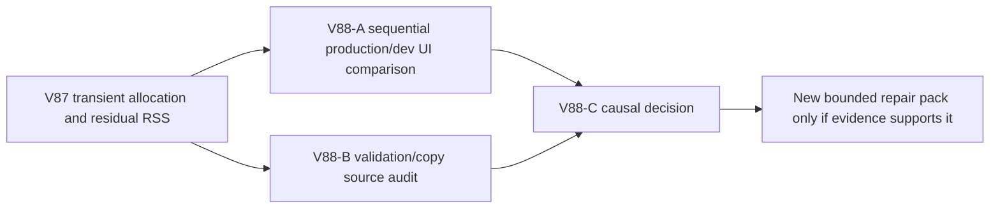

# Ticket Pack: V88 production versus development memory discriminator

## Outcome and evidence

The full Wizard Realms goal remains active. V87's genuine V31 checkpoint run allocated about 5.20 GB during a short D/A/W sequence. JS used heap fell to 53.5 MB after explicit GC while renderer RSS remained about 0.90 GB and then rose to 1.53 GB on reload. GPU process and DOM counts remained stable. V14 validation/comparison and V13 copying account for most measured allocations, with React development prop diff about 334 MB. Static scene audit found no bounded source edit that explains the RSS rise. We need distinguish development-only overhead from a production-runtime problem before choosing a repair.

## Scope and invariants

- V88-A builds the current engine once with `npm run build`, runs `vite preview` on an unused local port without stopping the existing dev server, and opens at most one isolated browser renderer. Use a fresh, ordinary V31 start under production and a comparable fresh start under dev in **sequential** browser sessions, with the same seed, visible route, and short timed D/A/W inputs. If exact input/state parity cannot be achieved, mark the comparison directional only. Do not silently transplant a saved origin to another port or modify private IndexedDB exports.
- Capture JS used/total heap, renderer/GPU RSS, DOM counts, CDP sampled allocations and top stacks, initial/idle/post-GC/reload values, frame cadence, and visible pose. Stop by 1.4 GB RSS or earlier if rising fast, close each renderer before the next. Preserve saved data and leave dev server running. Build output is generated artifact, not source; no code edits or GitHub actions.
- V88-B separately audits V14 immutable Greenway comparison and V13 copier costs, exact trust boundaries, and where repeated valid in-memory state is revalidated. Identify a bounded, fail-closed no-schema-change candidate only if it can preserve malicious mutation rejection, caller isolation, historical replay, witness equality, and save migration. No code/browser edits. Report NO-GO if optimization requires a structural save rewrite.
- Primary integrates these results before any implementation. A release-build improvement does not excuse dev-mode crashes, but may help prioritize a dev-only fix versus a runtime-wide simulation change.
- No PR/GitHub action. Future game GitHub work requires `gh-bioscopics`, personal noreply, and `ben/` branches. One Wizard renderer maximum, no Blender during UI proof.

## Lane graph

Dispatch verdict: PASS. The audits are independent. Only one browser renderer may exist at any time.

## Audit receipt, 2026-10-10

V88-B returned NO-GO for bypassing V14 or V13 checks. V14 validates mutable candidate immutables against a cached canonical 256-tile Greenway world; the V13 copier enforces descriptor, size, cycle, prototype, and detachment rules. Shared equality also protects checked writer replies. A source repair needs a measured narrow comparator or a larger explicit trust-boundary redesign, not an identity/hash shortcut.

V88-A built the engine successfully and compared sequential fresh V31 starts under production and dev, same visible D2s/A0.5s/W2s input. Endpoints differed by about 0.28 m, so the comparison is directional. Production sampled 2.164 GB movement allocations, 682 MB renderer RSS peak, 428 MB post-GC RSS, and 10.3 ms rAF p95; dev sampled 2.891 GB, 922 MB, 657 MB, and 17.9 ms. Reloads validated save #2 in both, with production RSS 674 MB and dev 1.107 GB. GPU RSS stayed around 170–176 MB. Production is lighter but still allocation-heavy. Both isolated browsers and temporary production preview were closed; dev server remains available.
