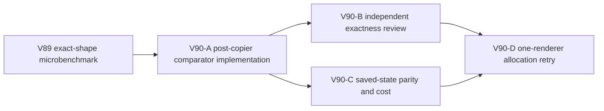

# Ticket Pack: V90 V14 immutable comparison allocation trial

## Outcome and evidence

The full Wizard Realms goal remains active. V87 measured about 5.20 GB transient allocation during a short V31 D/A/W input, with V14 validation and its value comparison prominent. V88 found production lighter but still allocation-heavy and rejected bypassing V14/V13 trust boundaries. V89's read-only microbenchmark on the exact rev98 Greenway immutable fields found a narrower option: after the V13 descriptor-safe copier, a key-iteration comparison matched tested oracle behavior while 3,000 repetitions fell from about 2,094 MB to 547 MB allocated in Node, and 676–686 ms to 358–370 ms. That is local benchmark evidence, not proof of whole-frame or browser impact.

## Scope and invariants

- Own only `engine/src/domain/publicWorldV14Validation.ts` and its existing focused validation test. Add a private exact comparator used **only** for the nine immutable Greenway fields in `validGreenway`, after `cloneBoundedPublicV13StateShape` has detached and shape-checked the candidate. Keep exported `samePublicV14Value` unchanged for dynamic resources/routes and writer equality.
- Preserve primitive equality, array length and sparse/extra-key behavior, own enumerable key count and values, ordinary-object shape, canonical field equality, and all malformed-input rejection. Do not rely on a hash, caller identity, unvalidated reference, or mutable cached candidate. Add malformed mutation, extra own key, symbol, nonenumerable, accessor, prototype, NaN, cycle, and valid canonical parity controls, with the V13 copier behavior made explicit.
- Run focused V14/V17/V23/V28/V31 tests and TypeScript. Independent reviewer checks exact comparator semantics and scope; deterministic validator compares exact rev98 17-frame outcomes, full views/status, witness, rev99 save, and allocation counts. Only after both GO and a stable build may one renderer repeat the exact four-second saved-state sample; baseline V86 is 3.367 GB movement allocation, 812.8 MB RSS peak. Stop below 1.4 GB RSS, close renderer.
- The ongoing V89 production UI stage must finish and close its renderer before source edit to avoid HMR invalidating its evidence. One renderer maximum, no Blender during browser proof. No PR/GitHub action; future game GitHub work requires `gh-bioscopics`, personal noreply, and `ben/` branches.

## Lane graph

Dispatch verdict: PASS after V89 UI renderer closes. The source owner is exclusive. Review and deterministic validation can run in parallel, and browser sampling requires both GO receipts.

## Stop rule

If any malformed input changes acceptance or full replay parity differs, do not use the candidate. If whole-browser allocation benefit is trivial, retain only if the local simplification is clear and safe; do not claim renderer stability from a microbenchmark.

## Validation receipt, 2026-10-10

V90-A changed only V14 validation and its existing focused test. Six requested V14/V17/V23/V28/V31 suites passed 86/86 and TypeScript passed. Independent review returned GO, confirming that the private comparator is called only on nine canonical immutable Greenway fields after the descriptor-safe V13 copy; exported equality remains for dynamic fields and writer replies. Independent exact rev98 differential replay matched 17 accepted frames, full views/status, 23 events, witness, and strict rev99 save. Thirteen canonical/malformed controls matched. The actual `Object.keys` helper used about 52% less allocation and ran about 2.8 times faster than the old comparator on the isolated saved immutable fields.

The corrected one-renderer CDP sample with collected objects included showed four-second held-W allocation 3.367→3.310 GB, about 1.7% lower; the comparator stack fell about 237→63.9 MB, while V14 validator self-allocation stayed around 666 MB. Renderer RSS rose to 1.24 GB during extended monitoring, so the tester closed before final pose/reload. The first profiling attempt omitted collected objects and is not used as evidence. This is a safe narrow hot-path improvement, not proof of renderer stability or V79 gameplay completion.
